# TP2 : Identités, RBAC, MFA, SSO et OIDC avec Authentik

> **Nova Services** · Gouvernance des identités & habilitations
> Gestion des comptes, contrôle des accès, MFA et connexion de Grafana en OIDC.

## Sommaire

| Identités | MFA | SSO et accès |
|---|---|---|
| [1. Laboratoire](#1-vérifier-le-laboratoire) | [7. Préparer le MFA](#7-préparer-le-mfa) | [12. Flux OIDC](#12-flux-sso-oidc) |
| [2. Comptes](#2-créer-les-identités) | [8. TOTP](#8-enrôler-les-totp) | [13. Claim de groupes](#13-claim-de-groupes) |
| [3. Attributs](#3-attributs-métier) | [9. Codes de secours](#9-codes-de-récupération) | [14. Provider et application](#14-provider-et-application) |
| [4. Cycle de vie](#4-cycle-de-vie) | [10. MFA obligatoire](#10-mfa-obligatoire) | [15. Grafana OIDC](#15-configurer-grafana) |
| [5. Matrice RBAC](#5-matrice-rbac) | [11. Récupération](#11-récupération-daccès) | [16. SSO et rôles](#16-sso-et-rôles) |
| [6. Groupes](#6-groupes-et-affectations) | | [17. Dossiers](#17-accès-par-dossier) |
| | | [18. JWT](#18-jwt) |
| | | [19. Départ de Bob](#19-départ-dun-collaborateur) |
| | | [20. SSO seul](#20-parcours-sso-final) |
| [Livrables](#livrables) | [Questions](#questions-de-compréhension) | |

---

## 1. Vérifier le laboratoire

- 5 services `healthy` ✅
- Flow de connexion Authentik : code 0 ✅
- Grafana `/api/health` : `database: ok` ✅
- Pas de Redis : Authentik 2026.8 n'en utilise plus

> **❓ Pourquoi ne pas publier PostgreSQL ?**
> Seul Authentik l'utilise, via le réseau Docker. Le publier exposerait la base d'identités sans besoin.

---

## 2. Créer les identités

**Répertoire → Utilisateurs**, type interne, chemin `users`, actif :

| Username | Nom | Email |
|---|---|---|
| `alice` | Alice Martin | alice@nova-services.test |
| `bob` | Bob Dupont | bob@nova-services.test |
| `charlie` | Charlie Bernard | charlie@nova-services.test |

- Mot de passe unique défini sur chaque fiche ✅
- Chacun accède au portail, sans application ✅
- Charlie n'administre pas Authentik ✅

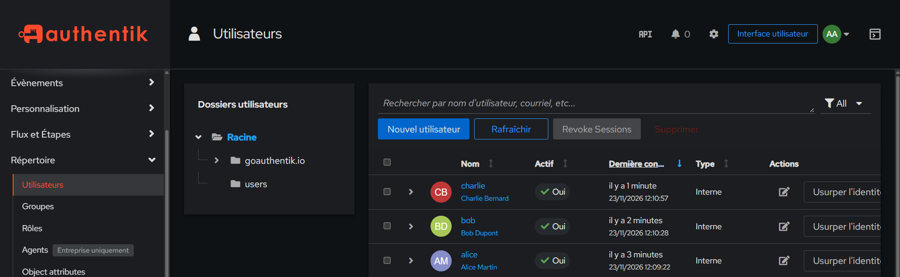

| Alice | Bob | Charlie |
|---|---|---|
| 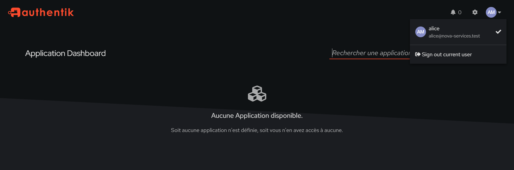 | 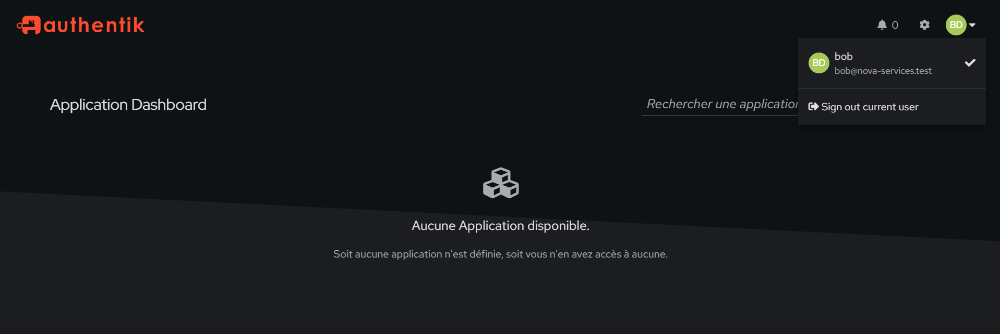 | 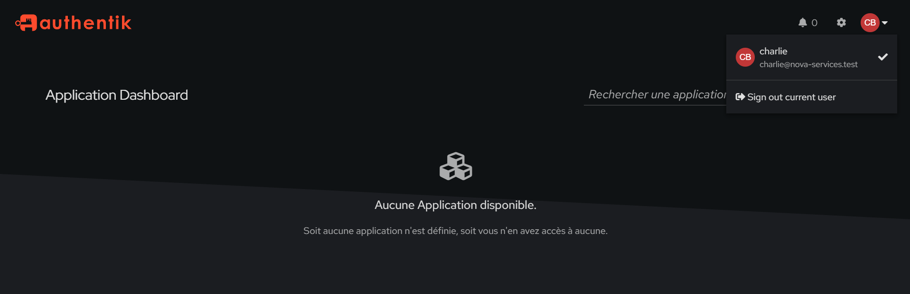 |

---

## 3. Attributs métier

| Utilisateur | `department` | `role` | `clearance_level` |
|---|---|---|---|
| alice | RH | Manager RH | 2 |
| bob | Development | Backend Developer | 1 |
| charlie | IT | System Administrator | 5 |

- `clearance_level` stocké en nombre ✅
- Détail dans [docs/comptes.md](docs/comptes.md)

> 💡 `role` est une donnée métier : aucun droit tant qu'une règle ne l'exploite pas.

> **❓ Règle `department == IT` et `clearance_level >= 3`**
> - Qui la satisfait ? **Charlie** seul.
> - Pourquoi l'utilisateur ne modifie pas son habilitation ? Il s'attribuerait lui-même des accès.
> - Charlie au niveau 2 ? La règle devient **fausse**.

---

## 4. Cycle de vie

| Situation | Opérations |
|---|---|
| **Joiner** | Créer, initialiser les facteurs, attribuer les accès approuvés |
| **Mover** | Retirer les anciens droits, attribuer les nouveaux |
| **Leaver** | Bloquer, révoquer sessions et jetons, retirer les droits |

**Suspension de Bob**
1. Décocher **Actif**
2. Connexion avec le bon mot de passe : **refusée** ✅
3. Fiche et attributs conservés ✅
4. Réactivation : connexion **acceptée** ✅

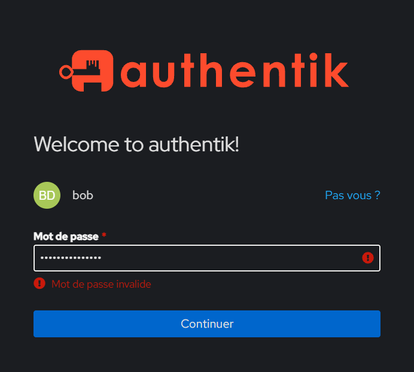

> 💡 Authentik affiche « Mot de passe invalide » : il ne révèle pas que le compte est désactivé.

> **❓ Fermer le compte ou fermer les sessions ?**
> Désactiver bloque les **nouvelles** connexions. Les sessions déjà ouvertes dans les applications continuent : il faut les révoquer (démontré à l'étape 19).

---

## 5. Matrice RBAC

| Groupe | Membre | Rôle Grafana |
|---|---|---|
| Admin | Charlie | Admin |
| Dev | Bob | Editor |
| RH | Alice | Viewer |
| Audit | Aucun | Viewer |

- Admin d'organisation ≠ GrafanaAdmin (serveur)
- Editor n'est pas limité au dossier Dev
- Audit ne donne pas accès aux journaux Authentik

Détail dans [docs/rbac.md](docs/rbac.md).

---

## 6. Groupes et affectations

1. Créer `Admin`, `Dev`, `RH`, `Audit` : non superutilisateur, sans parent
2. Affecter : alice → RH, bob → Dev, charlie → Admin
3. Audit reste vide

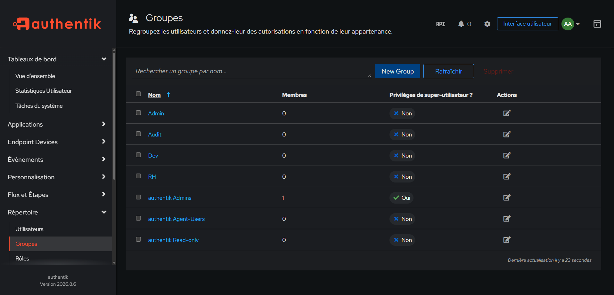

| Alice | Bob | Charlie |
|---|---|---|
| 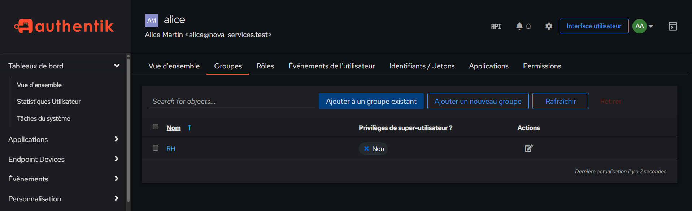 | 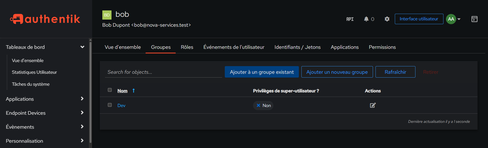 | 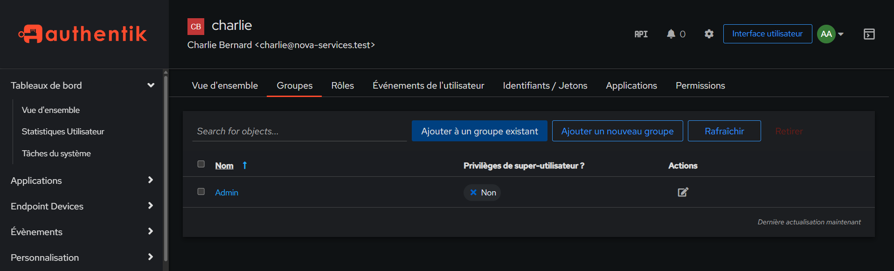 |

Charlie, membre de `Admin`, n'a pas accès à l'administration Authentik ✅

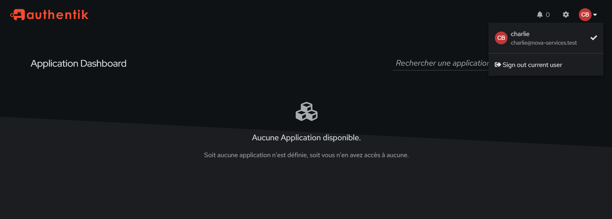

**Mobilité de Bob** : Dev → Audit, puis retour dans Dev.

> **❓ Pourquoi ne pas garder les deux appartenances ?**
> Bob cumulerait Editor (Dev) et Viewer (Audit) : accumulation de privilèges contraire au moindre privilège.

---

## 7. Préparer le MFA

| Facteur | Exemple |
|---|---|
| Ce que je connais | Mot de passe |
| Ce que je possède | Application TOTP (6 chiffres, 30 s) |
| Ce que je suis | Biométrie |

**Précautions**
- Session `akadmin` gardée ouverte, essais dans un autre navigateur
- Configuration du flow relevée dans `captures/` (exclu de Git)
- Heure de l'hôte et du conteneur synchronisées ✅

**Flow `default-authentication-flow`** : identification (10) → mot de passe (20) → MFA (30) → login (100)

**Test de référence** : Alice, mot de passe seul → connexion acceptée, **pas de second facteur** (action `skip`).

---

## 8. Enrôler les TOTP

Pour `akadmin`, `charlie`, `alice`, `bob` :
1. **Paramètres → Appareils de MFA → S'inscrire → TOTP**
2. Scanner le QR code
3. Saisir le code pour confirmer

| Compte | Appareil |
|---|---|
| akadmin | Nova Services - Akadmin ✅ |
| charlie | Nova Services - Charlie ✅ |
| alice | Nova Services - Alice ✅ |
| bob | Nova Services - Bob ✅ |

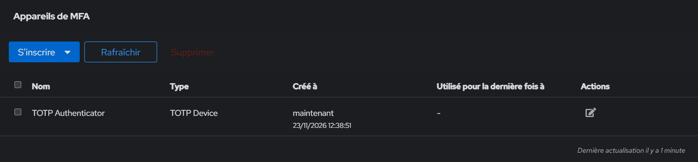

> 💡 Le QR code contient le secret partagé : jamais de capture. L'enrôlement initial se fait dans un contexte de confiance.

---

## 9. Codes de récupération

Pour `akadmin` et `charlie` :
1. **S'inscrire → Static tokens**
2. Copier les codes dans le gestionnaire de mots de passe
3. Cliquer sur **Continuer** pour les enregistrer

- 6 codes par compte ✅
- Usage unique, conservés hors du téléphone

> ⚠️ Sans **Continuer**, les codes affichés ne sont pas enregistrés.

---

## 10. MFA obligatoire

Stage `default-authentication-mfa-validation` :

| Paramètre | Avant | Après |
|---|---|---|
| Classes | static, totp, webauthn, duo, sms, email | **static, totp** |
| Si non configuré | skip | **deny** |
| Seuil | seconds=0 | seconds=0 |

| Option | Effet |
|---|---|
| Skip | Sans appareil, l'utilisateur passe |
| **Deny** | Sans appareil, l'utilisateur est refusé |
| Configure | Déclenche l'enrôlement |

| Test | Résultat |
|---|---|
| Charlie, TOTP valide | Accepté ✅ |
| Charlie, code faux | Refusé à l'étape MFA ✅ |
| Alice | Second facteur demandé ✅ |
| akadmin, TOTP | Accepté ✅ |

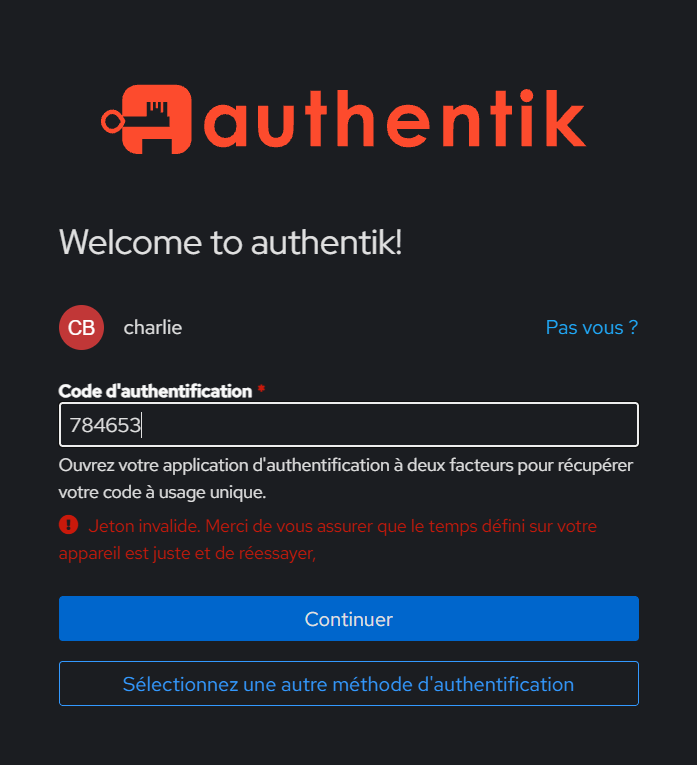

> ⚠️ Le TOTP ne résiste pas au phishing en temps réel ni au vol de session. FIDO2/WebAuthn résiste au phishing.

---

## 11. Récupération d'accès

Téléphone de Charlie indisponible :
1. Mot de passe
2. **Autre méthode → Static**
3. Code de secours : **accepté** ✅
4. Même code après déconnexion : **refusé** ✅

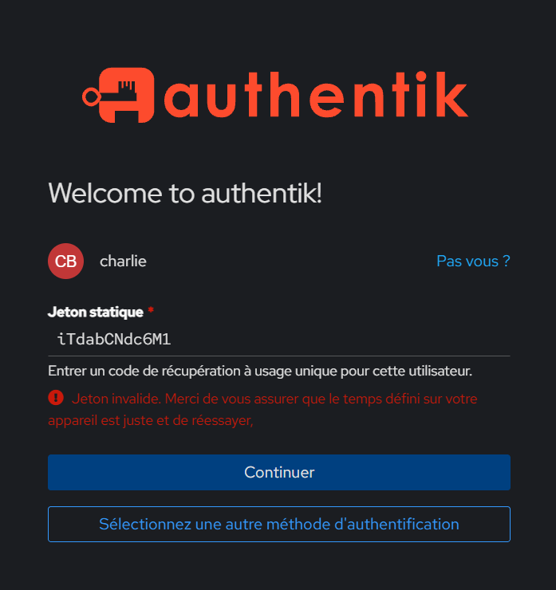

Procédure complète : [docs/recovery.md](docs/recovery.md).

> **❓ Pourquoi protéger un code de récupération comme un secret ?**
> Avec le mot de passe, il remplace le second facteur : qui le détient contourne le MFA.

---

## 12. Flux SSO OIDC

- **Authentik** : fournisseur d'identité, authentifie avec MFA
- **Grafana** : client OIDC, crée **sa propre session**
- **Front-channel** : le navigateur transporte le code (`localhost:9000`)
- **Back-channel** : Grafana échange le code (`authentik-server:9000`)

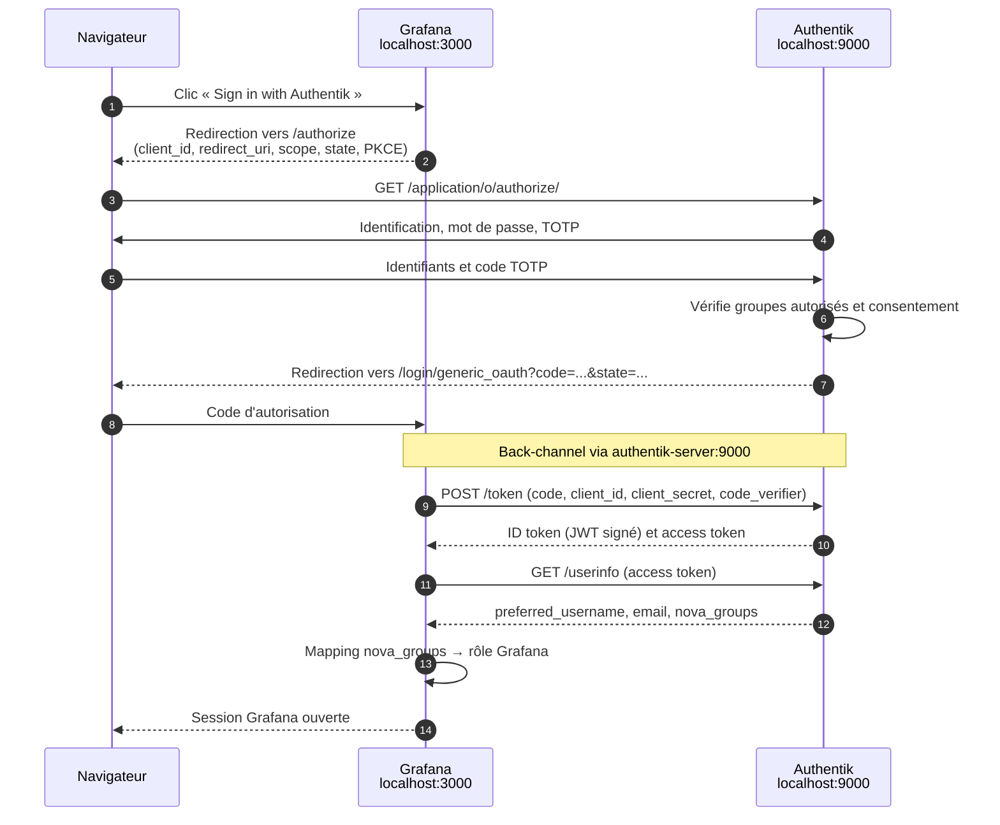

> 💡 Le code seul est inutile : il faut aussi le Client Secret et le vérificateur PKCE.

---

## 13. Claim de groupes

**Personnalisation → Mappages de propriétés → Mappage de Portée** `nova-grafana-groups`, scope `nova_groups` :

```python
allowed_groups = {"Admin", "Dev", "RH", "Audit"}
return {
    "nova_groups": [
        group.name
        for group in request.user.groups.all()
        if group.name in allowed_groups
    ]
}
```

| Utilisateur | Claim |
|---|---|
| alice | `["RH"]` ✅ |
| bob | `["Dev"]` ✅ |
| charlie | `["Admin"]` ✅ |

> 💡 Le mapping doit être sélectionné dans le provider et le scope demandé par Grafana.

---

## 14. Provider et application

**Provider `nova-grafana-oidc`**
- Client confidentiel
- Flux d'authentification avec MFA, consentement explicite
- Redirect URI `http://localhost:3000/login/generic_oauth` en **strict**
- Clé `authentik Self-signed Certificate`
- Scopes : openid, profile, email, **nova-grafana-groups**

**Application `grafana`**
- Mode **ANY**, liaisons Admin, Dev, RH, Audit

**Découverte OIDC** : `issuer`, `authorize`, `token`, `userinfo`, `jwks` ✅ ; `scopes_supported` inclut `nova_groups` ✅

> 💡 **ANY** : un groupe suffit. **ALL** exigerait les quatre.

> **❓ Pourquoi une Redirect URI exacte ?**
> Le code n'est envoyé qu'à une adresse enregistrée : un attaquant ne peut pas le détourner vers son site.

---

## 15. Configurer Grafana

**Variables**
- `.env` : Client ID et Client Secret réels, hors Git
- [.env.example](.env.example) : valeurs factices

**Service Grafana** ([docker-compose.yml](docker-compose.yml))
- Scopes `openid profile email nova_groups`, PKCE
- `AUTH_URL` sur `localhost`, `TOKEN_URL` et `API_URL` sur `authentik-server`
- Mode strict, GrafanaAdmin interdit
- Validation de l'ID token via `jwks/`
- `GF_SECURITY_ADMIN_*` conservés (ajout hors TP : évite `admin/admin` si le volume est recréé)

| Groupe | Rôle |
|---|---|
| Admin | Admin |
| Dev | Editor |
| RH ou Audit | Viewer |
| Aucun | Refus (strict) |

**Contrôles** : config valide, Grafana `healthy`, aucune erreur OAuth, back-channel joignable, bouton Authentik présent ✅

> ⚠️ `docker restart` ne recharge pas les variables : recréer le conteneur.

---

## 16. SSO et rôles

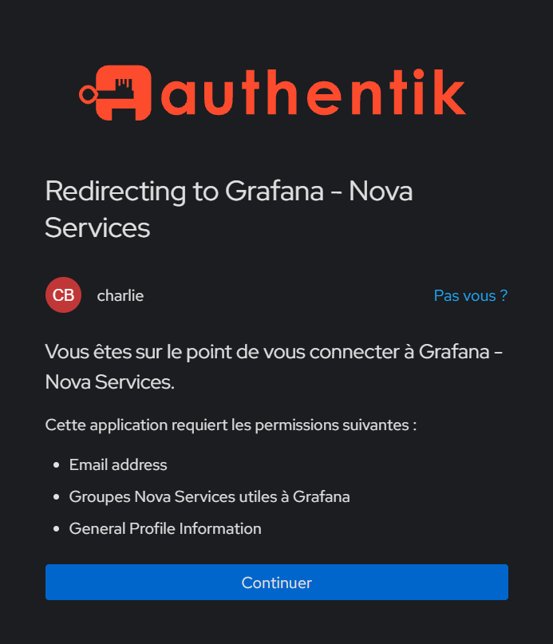

| Utilisateur | Rôle Grafana | Admin serveur |
|---|---|---|
| alice | **Viewer** ✅ | Non |
| bob | **Editor** ✅ | Non |
| charlie | **Admin** ✅ | **Non** ✅ |

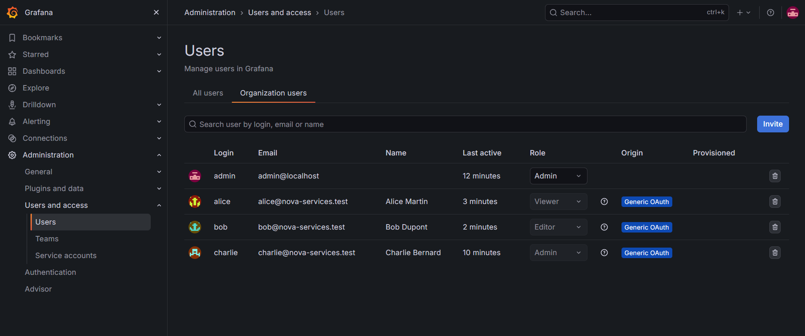

> 💡 `akadmin` est refusé par le bouton Authentik : il n'appartient à aucun groupe lié.

**Test fonctionnel**
1. Charlie crée `Nova Services - Démonstration IAM` ✅
2. Alice consulte sans pouvoir modifier ✅
3. Bob modifie et enregistre ✅

| Charlie | Alice | Bob |
|---|---|---|
| 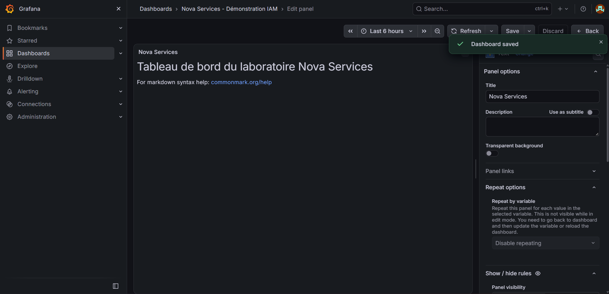 | 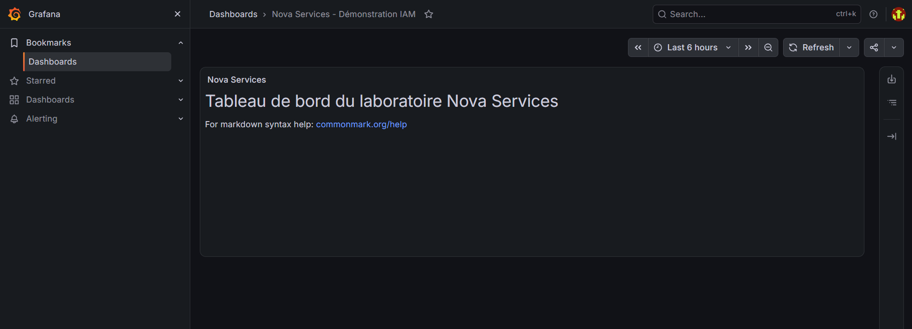 | 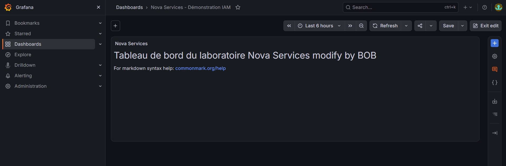 |

**Mobilité de Bob** : Dev → Audit, nouvelle connexion → **Viewer** ✅, puis retour Editor.

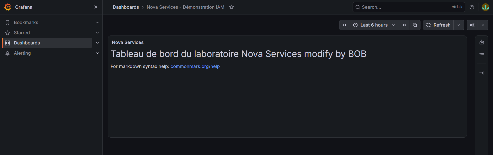

**Alice sans groupe** : nouvelle connexion → **Permission refusée** ✅, puis retour dans RH.

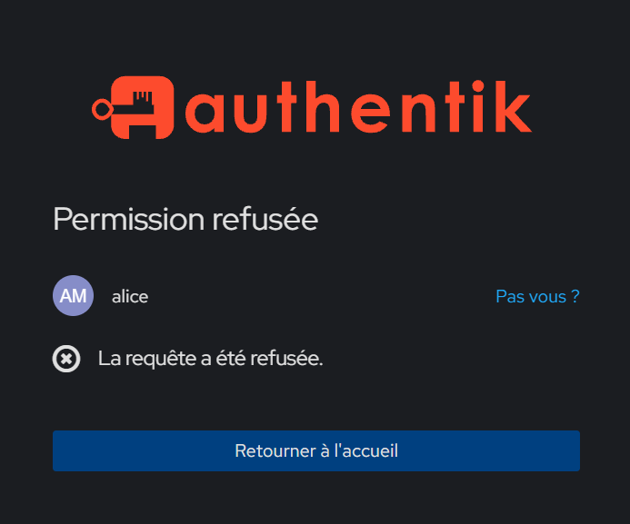

> 💡 Le rôle n'est recalculé qu'à une nouvelle connexion OAuth. Deux contrôles : bindings Authentik, puis mode strict Grafana.

---

## 17. Accès par dossier

1. Équipes `nova-dev` (bob) et `nova-rh` (alice)
2. Dossiers `Dev` et `RH`, rôles généraux Viewer et Editor retirés
3. `Dev` → `nova-dev` en **Edit**, `RH` → `nova-rh` en **View**
4. Un tableau Text par dossier

| Dev | RH |
|---|---|
| 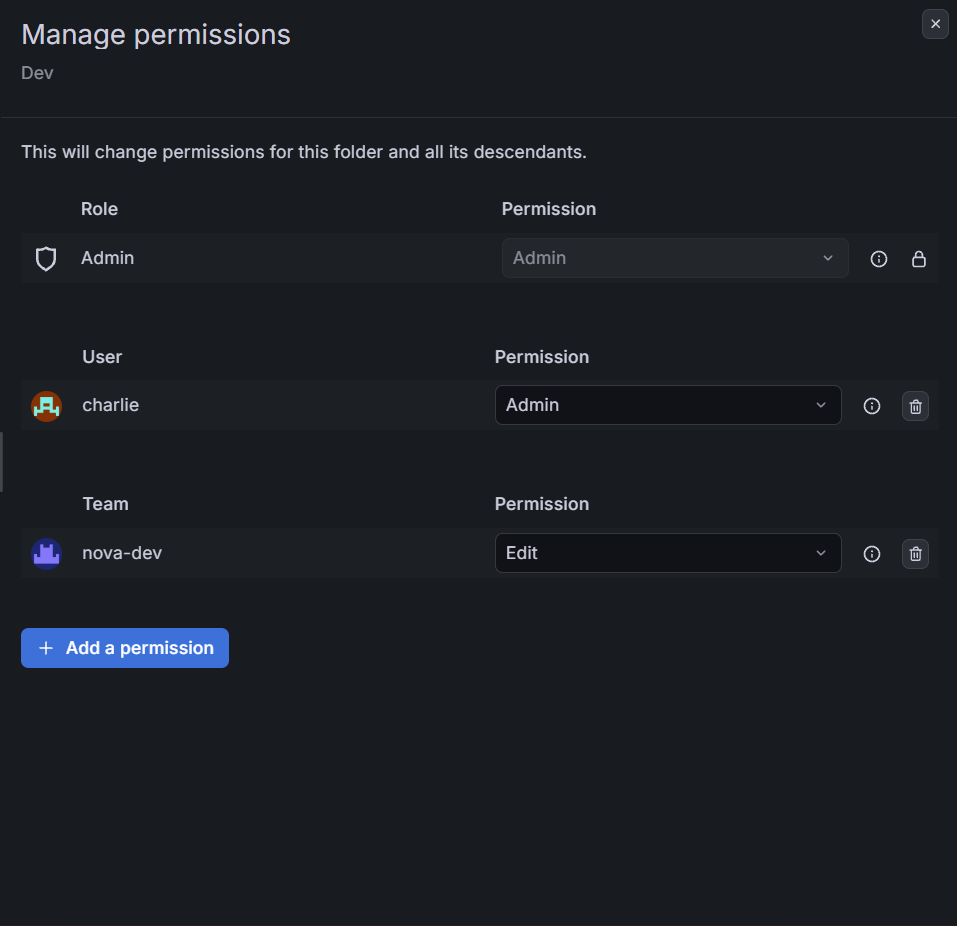 | 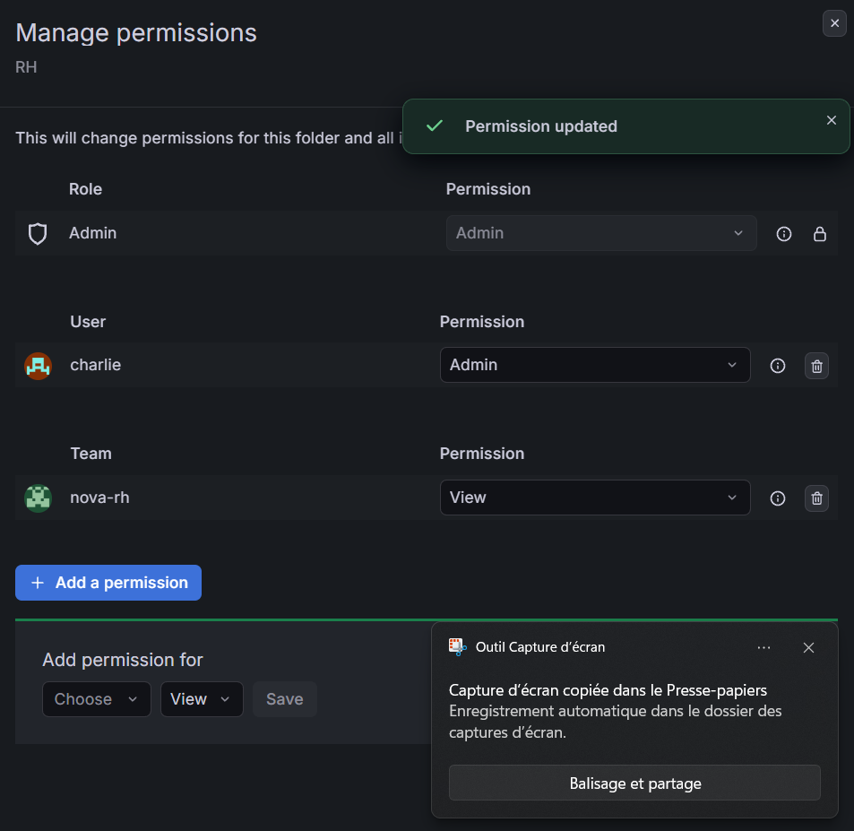 |

| Compte | Dossier Dev | Dossier RH |
|---|---|---|
| Bob | Modification | **Forbidden** ✅ |
| Alice | **Forbidden** ✅ | Lecture |
| Charlie | Administration | Administration |

| Bob → RH | Alice → Dev |
|---|---|
| 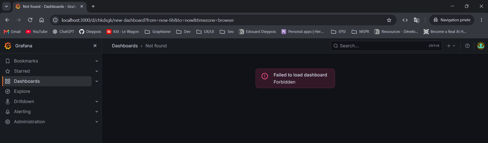 | 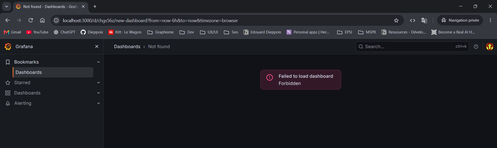 |

> ⚠️ Les équipes Grafana sont gérées à la main : le mapping OIDC ne les synchronise pas.

> 💡 Seul le test par URL directe prouve un refus. Les dossiers n'isolent pas les sources de données.

---

## 18. JWT

Payload **fictif** :

```json
{
  "iss": "http://localhost:9000/application/o/grafana/",
  "sub": "identifiant-stable-opaque-de-charlie",
  "aud": "identifiant-du-client-grafana",
  "iat": 1800000000,
  "exp": 1800000300,
  "preferred_username": "charlie",
  "email": "charlie@nova-services.test",
  "nova_groups": ["Admin"]
}
```

| Claim | Signification |
|---|---|
| `iss` | Émetteur |
| `sub` | Identifiant stable, pas le username |
| `aud` | Destinataire : Client ID de Grafana |
| `iat` / `exp` | Émission / expiration |
| `nova_groups` | Claim personnalisée du mapping |

- La signature garantit l'**intégrité** et l'**émetteur**, pas la confidentialité
- Décoder le Base64URL ne valide pas la signature
- Validation complète : signature, `iss`, `aud`, `exp`, `state`, PKCE

> ⚠️ Jamais de vrai jeton dans un décodeur en ligne.

> **❓ Mini-exercice**
> - `nova_groups` modifié sans nouvelle signature ? Le jeton doit être **rejeté**.
> - Pourquoi vérifier `aud` ? Pour refuser un jeton émis pour une autre application.
> - Jeton ou session ? Le jeton expire vite ; la session Grafana a sa propre durée et peut lui survivre.

---

## 19. Départ d'un collaborateur

**19.1 Session existante**
1. Bob connecté à Grafana
2. Bob désactivé dans Authentik
3. Nouvelle authentification : **refusée** ✅
4. Session Grafana actualisée : **Bob reste connecté** ⚠️ (4 sessions actives)

> 💡 Le bouton **Actif** de l'IdP ne ferme pas les sessions applicatives.

**19.2 Retrait des accès**

| Action | Résultat |
|---|---|
| Sessions Authentik | 0 (supprimées à la désactivation) ✅ |
| Groupe `Dev` | Retiré ✅ |
| Jetons OAuth | Aucun à révoquer ✅ |
| Sessions Grafana | **0** après révocation ✅ |
| Équipe `nova-dev` | Bob retiré ✅ |
| Permissions directes | Aucune ✅ |
| Désactivation Grafana | Refusée : compte externe (OAuth) ⚠️ |
| Retrait de l'organisation | Profil Grafana supprimé (seule organisation) |

> 💡 Le compte Authentik reste désactivé et conservé : c'est la référence pour l'archivage. Le SSO ne gère pas tout le cycle de vie : chaque application a besoin de son mécanisme (API, SCIM, procédure).

**État final**

| Compte | Actif | Groupe | Grafana |
|---|---|---|---|
| alice | Oui | RH | Viewer, dossier RH |
| bob | **Non** | Aucun | Aucun accès |
| charlie | Oui | Admin | Admin d'organisation |

---

## 20. Parcours SSO final

```yaml
GF_AUTH_DISABLE_LOGIN_FORM: "true"
GF_AUTH_BASIC_ENABLED: "false"
```

- Formulaire local masqué ✅
- Bouton Authentik seul ✅
- Basic Auth `admin` sur l'API : HTTP 401 ✅

> 💡 Masquer le formulaire ne supprime pas les comptes locaux et ne révoque ni sessions ni jetons API.

Procédure de secours en cas de panne de l'IdP : [docs/recovery.md](docs/recovery.md).

---

## Livrables

| Livrable | Emplacement |
|---|---|
| Comptes et états | [docs/comptes.md](docs/comptes.md) |
| Groupes, rôles, dossiers | [docs/rbac.md](docs/rbac.md) |
| Recette | [docs/tests.md](docs/tests.md) |
| Récupération et secours | [docs/recovery.md](docs/recovery.md) |
| Configuration sans secret | [docker-compose.yml](docker-compose.yml), [.env.example](.env.example) |
| Schéma OIDC | [Étape 12](#12-flux-sso-oidc) |
| Captures | `pictures/tp2-*` |

---

## Questions de compréhension

**1. Identité, authentification, autorisation ?**
- Identité : qui est la personne.
- Authentification : la preuve que c'est elle.
- Autorisation : ce qu'elle a le droit de faire.

**2. Pourquoi l'attribut `role` ne donne-t-il aucun droit ?**
C'est une donnée métier : seule une règle explicite peut en faire un droit.

**3. Pourquoi Admin n'est pas superutilisateur Authentik ?**
Il administre Grafana, pas l'IdP : le contraire violerait le moindre privilège.

**4. Admin d'organisation ou GrafanaAdmin ?**
- Admin : une organisation.
- GrafanaAdmin : tout le serveur, interdit ici.

**5. Pourquoi Editor ne limite pas au département Dev ?**
C'est un rôle d'organisation : la limite vient des permissions de dossiers.

**6. Pourquoi retirer les anciens droits lors d'une mobilité ?**
Pour éviter l'accumulation de privilèges.

**7. Enrôler un TOTP ou imposer le MFA ?**
- Enrôler : l'utilisateur a un second facteur.
- Imposer : le flow l'exige (Deny).

**8. Pourquoi le TOTP reste vulnérable au phishing ?**
Un faux site peut relayer le code en temps réel. FIDO2/WebAuthn lie la preuve au domaine.

**9. Client ID, Client Secret, PKCE ?**
- Client ID : identifie Grafana (public).
- Client Secret : prouve que c'est Grafana (secret).
- PKCE : rend un code intercepté inutilisable.

**10. Pourquoi deux adresses Authentik ?**
Le navigateur joint `localhost:9000` ; dans le conteneur Grafana, `localhost` est Grafana lui-même, d'où `authentik-server:9000`.

**11. Rôle du code d'autorisation ?**
Preuve courte et unique d'authentification, échangeable seulement par Grafana.

**12. Pourquoi un JWT signé n'est pas confidentiel ?**
La signature protège l'intégrité ; le contenu reste lisible.

**13. Pourquoi le SSO ne supprime pas les fiches applicatives ?**
Grafana garde sa propre fiche (rôle, équipes, historique) : le SSO ne délègue que l'authentification.

**14. Pourquoi désactiver le compte IdP ne prouve pas la fermeture des sessions ?**
Bob désactivé gardait 4 sessions Grafana actives (étape 19).
