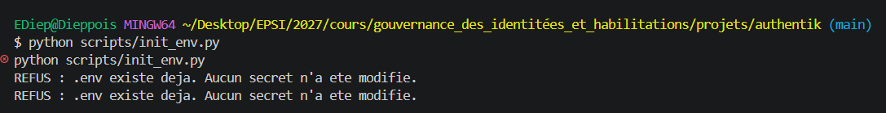
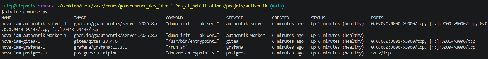
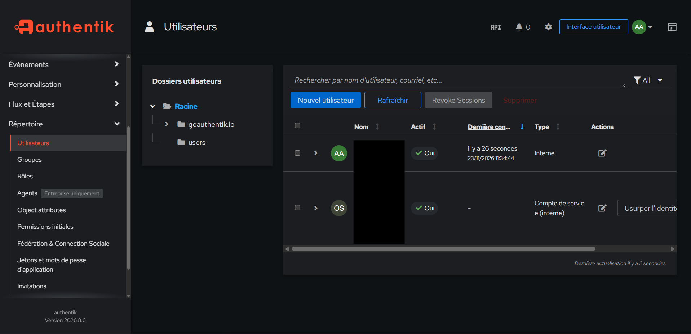
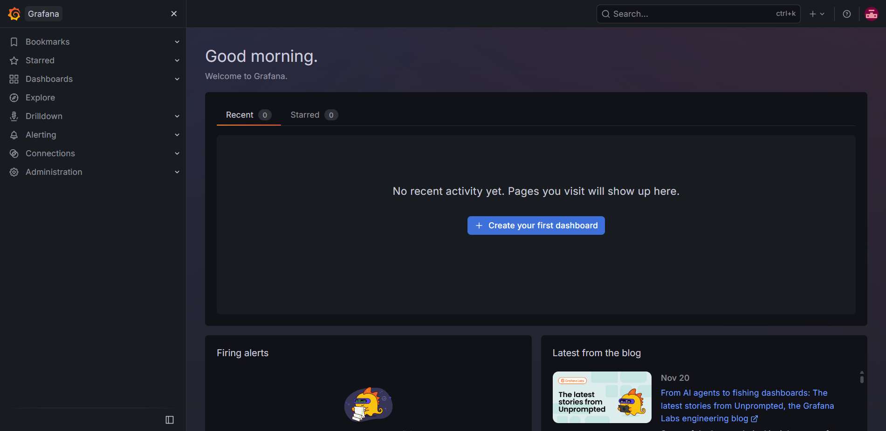
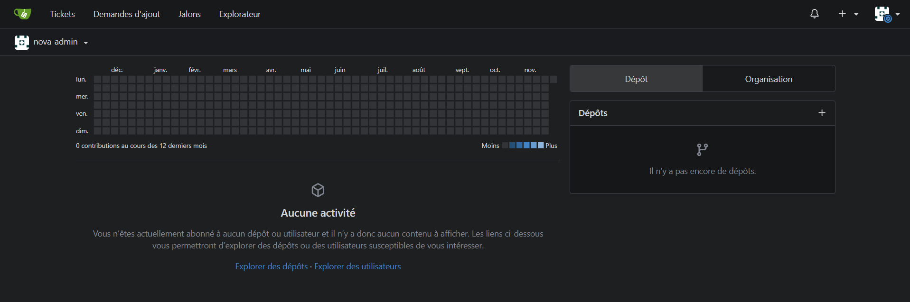
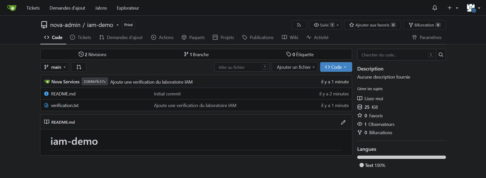
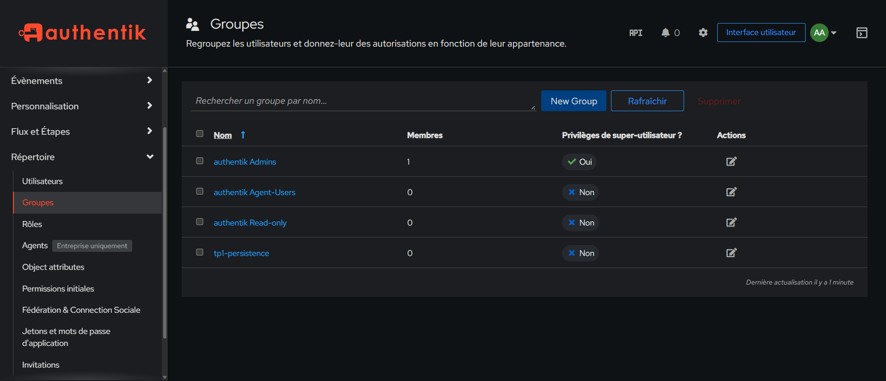

# TP1 : Authentik, Grafana et Gitea avec Docker

> **Nova Services** · Gouvernance des identités & habilitations
> Mise en place de la plateforme IAM et de deux applications clientes.

## Sommaire

| Installation | Initialisation | Validation |
|---|---|---|
| [1. Outils](#1-vérifier-les-outils) | [9. Authentik](#9-initialiser-authentik) | [14. Persistance](#14-persistance) |
| [2. Projet](#2-préparer-le-projet) | [10. Grafana](#10-initialiser-grafana) | [16. Sauvegarde](#16-sauvegarde-optionnel) |
| [3. Secrets](#3-générer-les-secrets) | [11. Gitea](#11-initialiser-gitea) | [17. Arrêt](#17-arrêt) |
| [4. Compose](#4-créer-le-compose) | [12. Dépôt privé](#12-dépôt-git-privé-optionnel) | [Rôle des services](#rôle-des-services) |
| [5. Configuration](#5-valider-la-configuration) | [13. Objets IAM](#13-objets-iam) | [Questions](#questions-de-compréhension) |
| [6. Images et droits](#6-images-et-droits) | | |
| [7. Démarrage](#7-démarrer-les-services) | | |
| [8. Contrôles](#8-contrôler-les-services) | | |

---

## 1. Vérifier les outils

- Docker **28.5.1**
- Docker Compose **v2.40.2**
- Python **3.13** (commande `python` sous Windows)
- Git **2.51**
- Ports **3000, 3001, 9000, 9443** libres

> **❓ Client installé ou moteur disponible ?**
> Le client (`docker`) envoie les commandes, le moteur (daemon) exécute les conteneurs. Ici `docker --version` répondait mais `docker ps` échouait tant que Docker Desktop était arrêté.

---

## 2. Préparer le projet

- Sous-dossiers `scripts/` et `docs/`
- `.gitignore` qui exclut :
  - `.env` et `.env.*` (sauf `.env.example`)
  - `data/`, `certs/`, `backups/`, `captures/`, `__pycache__/`

---

## 3. Générer les secrets

```bash
python scripts/init_env.py
```

- Crée `.env` sans afficher les valeurs :
  - `POSTGRES_PASSWORD`
  - `AUTHENTIK_SECRET_KEY`
  - `GRAFANA_ADMIN_PASSWORD`
- Une relance est refusée (code 1) ✅



> **❓ Pourquoi ne pas régénérer à chaque lancement ?**
> PostgreSQL et Authentik gardent les secrets du premier démarrage dans leurs données. De nouveaux secrets ne correspondraient plus : connexion à la base refusée, données Authentik illisibles.

---

## 4. Créer le Compose

[docker-compose.yml](docker-compose.yml) · projet `nova-iam` · réseau `iam-network`

| Service | Image | Accès hôte | Stockage |
|---|---|---|---|
| `postgres` | postgres:16-alpine | Aucun | `postgres_data` |
| `authentik-server` | goauthentik/server:2026.8.6 | 9000 (9443 réservé) | `./data/authentik` |
| `authentik-worker` | goauthentik/server:2026.8.6 | Aucun | `./data/authentik` |
| `grafana` | grafana/grafana:13.3.1 | 3000 | `grafana_data` |
| `gitea` | gitea/gitea:28.4.0 | 3001 → 3000 | `gitea_data` |

**Choix de sécurité**
- PostgreSQL non publié sur l'hôte
- Secrets injectés uniquement là où ils servent
- Authentik attend que PostgreSQL soit `healthy`
- Worker en root, sans socket Docker
- Grafana et Gitea sans inscription publique

---

## 5. Valider la configuration

```bash
docker compose config --quiet
```

- Aucune sortie, code 0 ✅
- 5 services et images attendus ✅

---

## 6. Images et droits

1. `docker compose pull`
2. `chown -R 1000:1000 /data` via `docker compose run`

> 💡 Sous Git Bash, préfixer par `MSYS_NO_PATHCONV=1`.

---

## 7. Démarrer les services

```bash
docker compose up -d --wait --wait-timeout 600
```

1. Premier lancement : worker `unhealthy` ⚠️
2. Cause : migrations plus longues que le `start_period` de 120 s
3. Après le contrôle suivant : worker `healthy`
4. Relance : code 0, **5 services `healthy`** ✅



---

## 8. Contrôler les services

| Contrôle | Résultat |
|---|---|
| PostgreSQL `SELECT 1` | 1 ✅ |
| Authentik live et ready | HTTP 200 ✅ |
| Worker `ak healthcheck` | Code 0 ✅ |
| Grafana `/api/health` | `database: ok` ✅ |
| Gitea | HTTP 200 (assistant) ✅ |

---

## 9. Initialiser Authentik

1. Ouvrir `http://localhost:9000/if/flow/initial-setup/`
2. Créer le compte `akadmin` (e-mail `iam-admin@nova-services.test`)
3. Ouvrir l'interface d'administration ✅



---

## 10. Initialiser Grafana

1. Ouvrir `http://localhost:3000`
2. Se connecter avec `admin` et `GRAFANA_ADMIN_PASSWORD` ✅

> 💡 Ce mot de passe n'est appliqué qu'au premier démarrage.



---

## 11. Initialiser Gitea

1. Ouvrir `http://localhost:3001`
2. Configurer l'assistant :
   - SQLite3, port interne 3000
   - URL `http://localhost:3001/`
   - Inscription et mail désactivés
3. Créer l'admin `nova-admin`
4. Vérifier `/api/healthz` : `pass` ✅



---

## 12. Dépôt Git privé (optionnel)

- Dépôt privé `nova-admin/iam-demo`
- Clone et push du commit `2104bfb` ✅
- Accès anonyme : HTTP 404 ✅



---

## 13. Objets IAM

| Objet | Rôle |
|---|---|
| User | Identité d'une personne ou d'un service |
| Group | Regroupement pour attribuer des accès |
| Attribute | Information sur l'identité (département) |
| Flow | Parcours d'étapes (connexion, MFA) |
| Stage | Une étape d'un flow |
| Provider | Protocole d'intégration (OIDC) |
| Application | Application contrôlée par Authentik |
| Policy | Règle conditionnant un accès |

---

## 14. Persistance

1. Créer le groupe `tp1-persistence`
2. `docker compose down` (sans `-v`)
3. `docker compose up -d --wait --wait-timeout 600`
4. Vérifier : `akadmin` et le groupe existent toujours ✅
5. Supprimer le groupe



> **❓ Pourquoi garder le nom de projet `nova-iam` ?**
> Les volumes sont préfixés par ce nom (`nova-iam_postgres_data`). Un autre nom créerait des volumes vides.

---

## 16. Sauvegarde (optionnel)

- `pg_dump -Fc` vers `backups/authentik-20261123-115352.dump` (3 Mo)
- `pg_dump`, `test -s` et `pg_restore --list` : code 0 ✅
- `backups/` exclu de Git

---

## 17. Arrêt

**État avant le TP2**
- 5 services sains
- Comptes `akadmin`, `admin`, `nova-admin` opérationnels
- Alice, Bob et Charlie non créés
- OIDC désactivé

**Pause**
```bash
docker compose stop
```

---

## Rôle des services

| Service | Rôle |
|---|---|
| `postgres` | Base de données d'Authentik |
| `authentik-server` | Fournisseur d'identité : interface, API, authentification |
| `authentik-worker` | Tâches de fond : migrations, tâches planifiées |
| `grafana` | Application de tableaux de bord |
| `gitea` | Forge Git |

---

## Questions de compréhension

**1. Rôle d'un fournisseur d'identité ?**
Centraliser comptes et authentification : une identité, un SSO, des règles communes, une désactivation unique.

**2. Authentification ou autorisation ?**
- Authentification : vérifier qui est l'utilisateur.
- Autorisation : décider ce qu'il peut faire.

**3. Pourquoi un serveur et un worker ?**
Le serveur répond aux utilisateurs, le worker traite les tâches longues sans ralentir les connexions.

**4. Pourquoi deux services sur le port 3000 ?**
Chaque conteneur a son propre réseau. Le conflit n'existe que sur l'hôte, d'où 3000 et 3001.

**5. Pourquoi ne pas publier PostgreSQL ?**
Seul Authentik l'utilise via le réseau Docker. Le publier exposerait la base sans besoin.

**6. `.env`, `.env.example`, gestionnaire de secrets ?**
- `.env` : vraies valeurs, locales et hors Git.
- `.env.example` : noms des variables, versionné.
- Gestionnaire : stockage chiffré, contrôle d'accès, traçabilité, rotation.

**7. Pourquoi garder la même clé Authentik ?**
Elle signe les sessions et chiffre des données. La changer les rend invalides.

**8. Pourquoi un Compose valide ne suffit pas ?**
Il vérifie la syntaxe, pas le démarrage réel. Le worker `unhealthy` de l'étape 7 le montre.

**9. Persistance ou sauvegarde ?**
- Persistance : survit à la recréation des conteneurs.
- Sauvegarde : copie séparée qui survit à la perte des volumes.

**10. Pourquoi tester la connexion Grafana locale avant le SSO ?**
Pour valider Grafana seul et garder un accès de secours si l'OIDC échoue.

**11. Pourquoi ne pas monter le socket Docker ?**
Il donne le contrôle de Docker, donc de l'hôte. Une faille de l'outil IAM compromettrait la machine.

**12. Que préserver pour une restauration complète ?**
- Compose et versions d'images
- `.env`, surtout `AUTHENTIK_SECRET_KEY`
- Dump PostgreSQL
- `data/authentik` et certificats
- Volumes Grafana et Gitea

**13. Pourquoi tester push et confidentialité ?**
Le healthcheck prouve seulement que le service répond.
- Le push teste l'authentification.
- L'accès anonyme refusé teste l'autorisation.
